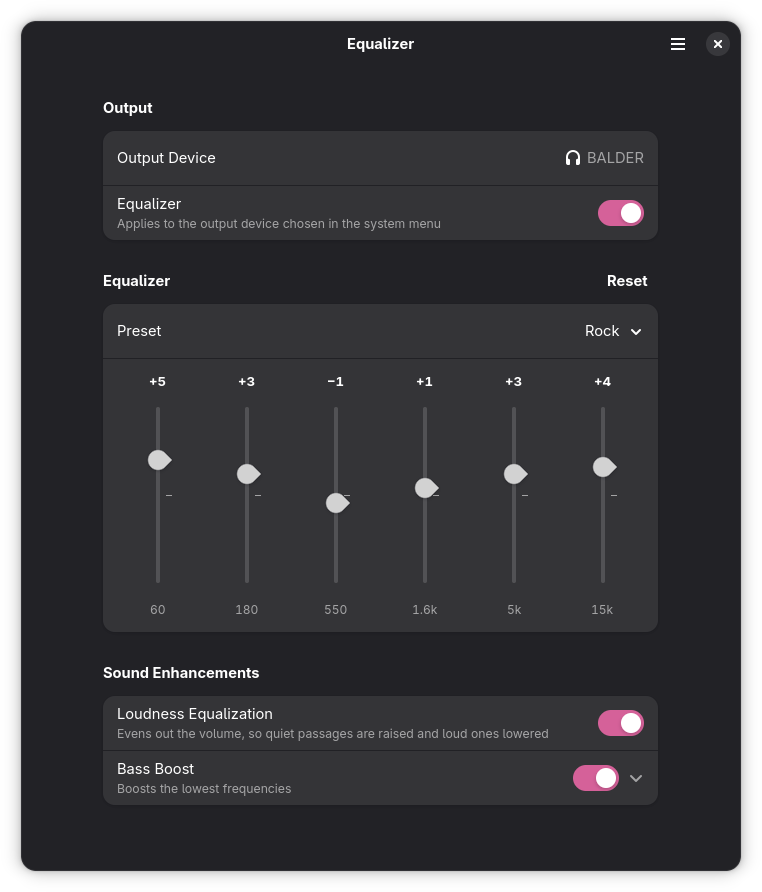
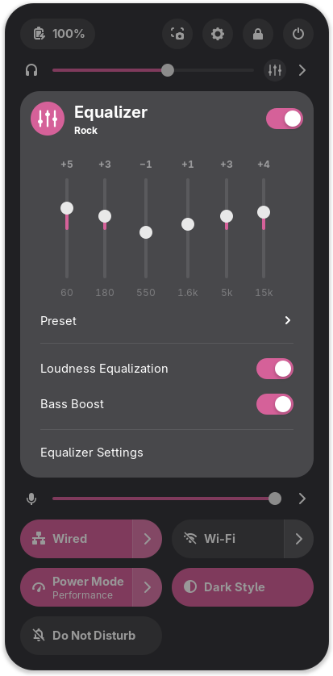

<div align="center">
<h1>Equalizer</h1>
<a href="#">
  
</a>
<a href="#">
  
</a>
<a href="#">
  
</a>
<a href="#">
  
</a>
<br><br>
<p>A six band equalizer with loudness equalization and bass boost for GNOME.</p>
<br>

&nbsp;

</div>

## Features

- **Six band equalizer**: 60 Hz, 180 Hz, 550 Hz, 1.6 kHz, 5 kHz and 15 kHz, from −12 to +12 dB,
  with presets (Flat, Bass, Treble, Vocal, Rock, Pop, Jazz, Classical, Electronic).
- **Loudness Equalization**: evens out the perceived volume, so quiet passages are raised
  and loud ones lowered (K-weighted level detector driving a slow automatic gain).
- **Bass Boost**: a low shelf at 110 Hz, from +1 to +12 dB.
- **In the system menu**: an equalizer button next to the volume slider opens a popup
  with the bands, the presets and both options.
- **Equalizer settings**: an app laid out like the Sound panel of GNOME Settings, opened from
  the popup, from *Activities* or by searching “equalizer”.
- **Follows the output device**: switch from the speakers to headphones in the system menu
  and the equalizer goes with you.
- Translated into the same 34 languages as Dash to Dock.

## How it works

```
apps ─▶ Equalizer (virtual sink) ─▶ 6 × peaking EQ ─▶ bass boost ─▶ loudness eq ─▶ limiter ─▶ default output
```

- `gnome-equalizer-daemon` (C, `daemon/`) is a PipeWire **smart filter**: WirePlumber
  0.5 links every stream that goes to the default output through it, and links its output to
  whatever device is the default. It reads its settings from GSettings, and parameter changes
  glide over 40 ms so moving a slider never clicks. A −1 dBFS peak limiter keeps boosts from
  clipping; when the equalizer is off the sound passes through untouched.
  It runs as the `gnome-equalizer.service` systemd user unit, started together with PipeWire.
- The GNOME Shell extension (`extension/`) adds the button and the popup, and hides the
  equalizer's own sink from the output device list.
- The settings app (`src/`, Python + libadwaita) edits the same settings
  (`io.github.cloudie_code.equalizer`).

The Sound panel of GNOME Settings cannot be extended by other programs, so the settings live in
their own app styled like that panel.

## Install

Equalizer is made of three parts that ship together: the audio filter (a systemd user
service), the settings app and the GNOME Shell extension. The packages below install all
three; the filter starts together with PipeWire, so there is nothing to enable besides the
extension.

Packages for each release are on the [Releases](https://github.com/cloudie-code/gnome-equalizer/releases) page.

### Arch Linux

```bash
sudo pacman -U gnome-equalizer-*.pkg.tar.zst
```

Or build it from [`packaging/arch/PKGBUILD`](packaging/arch/PKGBUILD) with `makepkg -si`.

### Debian and Ubuntu

```bash
sudo apt install ./gnome-equalizer_*.deb
```

### Fedora

```bash
sudo dnf install ./gnome-equalizer-*.x86_64.rpm
```

### Nix and NixOS

```bash
nix profile install github:cloudie-code/gnome-equalizer
```

On NixOS, use the flake's module so the service is started with PipeWire:

```nix
{
  inputs.gnome-equalizer.url = "github:cloudie-code/gnome-equalizer";

  outputs = { nixpkgs, gnome-equalizer, ... }: {
    nixosConfigurations.my-pc = nixpkgs.lib.nixosSystem {
      modules = [
        gnome-equalizer.nixosModules.default
        { programs.gnome-equalizer.enable = true; }
      ];
    };
  };
}
```

### Enable the extension

On Wayland, GNOME Shell only sees a newly installed extension after logging out and back in.
Then:

```bash
gnome-extensions enable equalizer@cloudie-code.github.io
```

### GNOME Shell extension only

The release also has `equalizer@cloudie-code.github.io.shell-extension.zip`, the extension on its
own (the same zip that goes to extensions.gnome.org). It only adds the popup: the sound is
processed by the `gnome-equalizer` service, so install one of the packages above as well.

```bash
gnome-extensions install equalizer@cloudie-code.github.io.shell-extension.zip
```

### From source

Dependencies (Arch Linux names): `glib2 pipewire pipewire-pulse wireplumber gtk4 libadwaita
python python-gobject libpulse gnome-shell` and, to build, `meson`.

For the current user, into `~/.local`:

```bash
just dev-setup
```

```bash
just install-user
```

System-wide:

```bash
meson setup build --prefix=/usr
```

```bash
meson install -C build
```

## Development

| Command               | What it does                                                 |
| --------------------- | ------------------------------------------------------------ |
| `just build-native`   | Build into `build/`                                          |
| `just test`           | DSP tests and desktop/metainfo/schema validation             |
| `just run-native`     | Run the settings app from `_native/`                         |
| `just run-daemon`     | Run the audio filter in the foreground                       |
| `just update-po`      | Regenerate `po/gnome-equalizer.pot` and merge the `.po`      |
| `just pack-extension` | Pack the extension zip for extensions.gnome.org into `dist/` |

Packaging lives in [`packaging/`](packaging) (`arch/`, `debian/`, `rpm/`, `nix/`, with the
flake at the root), and the GitHub workflows build every format; pushing a `v*` tag creates a
draft release with all of them.
